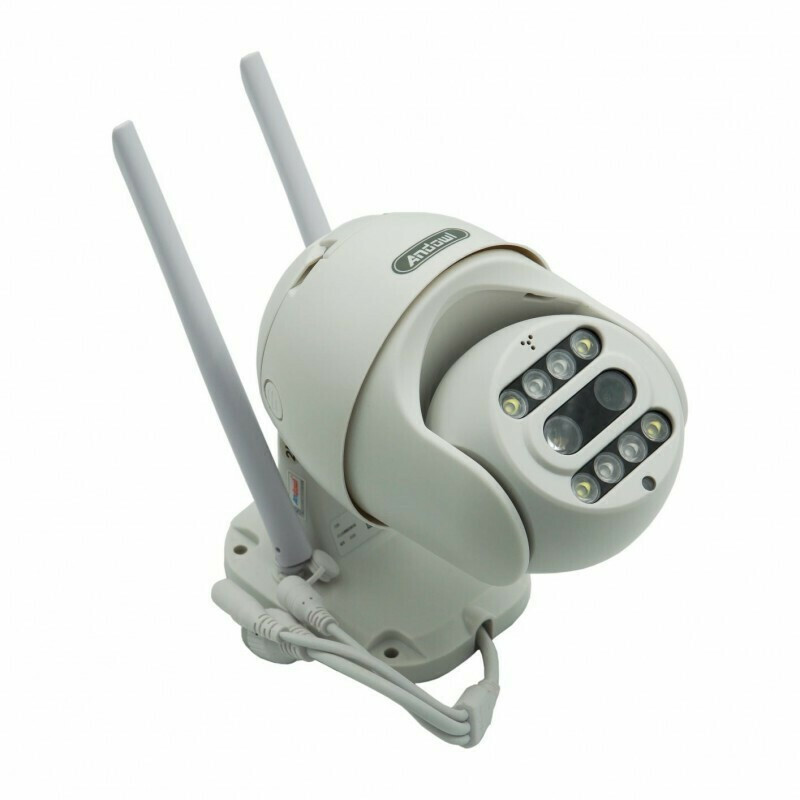

# Andowl Q-S2000 — what's actually inside

The **Andowl Q-S2000** (sold in South Africa as the *Full HD 4K Wireless Smart Camera – Waterproof Outdoor CCTV*) is a rebrand of a Chinese Fullhan-based PTZ camera line. This repo documents what I found on one unit.

> Everything here comes from a single unit on my personal bench. Other Q-S2000 / Andowl / rebrand units may use different silicon.

## The short version

- **SoC:** Fullhan FH8626V100 (ARMv6, 600 MHz), running **Linux 4.9.129**
- **Flash / RAM:** 8 MB SPI NOR, 512 Mbit DDR
- **WiFi:** USB Realtek RTL8188FU dongle
- **Video:** 1080p max (the "4K" in the marketing isn't real on my unit), H.264, 3.6 mm wide + 12 mm telephoto lenses
- **Console:** UART `ttyS0` @ 115200
- **Firmware:** `YGT.AJL33PQ0806-v220831.1043` (companion app: CareCamPro 2.8.23)

## Important notes

- **Local RTSP works with no cloud.** Port `8554`, Digest auth, vendor default `admin` / `admin123456`:
  `ffprobe rtsp://admin:admin123456@<cam>:8554/profile0`
- **Change that default password** if the camera is on a network you care about.
- **Other open ports:** telnet (23, login protected), plus 843, 1300 and 16668 (unknown protocol). No web server.
- **Scan slowly.** The 600 MHz device drops probes at normal nmap speeds and a fast scan will wrongly show only port 23. Use TCP with a low rate (e.g. `--max-rate 25`); it doesn't answer ping.
- **Config is plaintext JSON** (`.db` files), including cloud account identifiers.
- **Cloud:** the camera talks to `smartcloudcon.com` services; storage is on Huawei OBS and Tencent COS.

## Full technical details

For the complete hardware table, flash layout, cloud endpoints, app diagnostic log password, log archive layout and observed quirks, see the **[detailed README](docs/README-DETAILED.md)**.

## Status

Work in progress. More info will be added over time.
