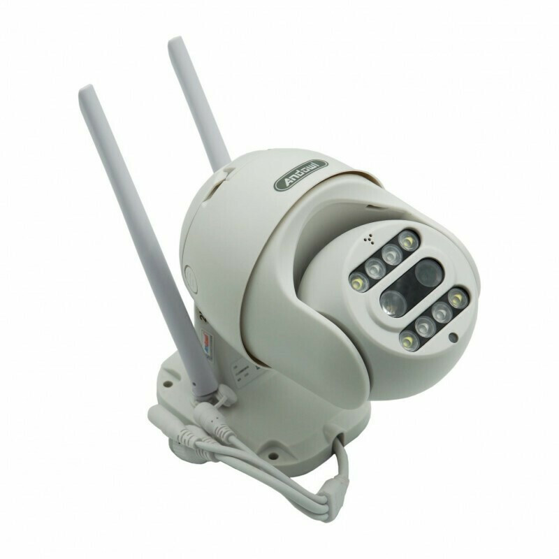

> ⬅️ Back to the [short overview](../README.md)

# Andowl Q-S2000 — what's actually inside

<div align="center">

| The camera | The box |
|---|---|
|  |  |

</div>

The **Andowl Q-S2000** ("Panoramic Camera", sold in South Africa as the *Full HD 4K Wireless Smart Camera – Waterproof Outdoor CCTV*) is one of the many rebrands of a Chinese Fullhan-based PTZ camera line.

- Listing: <https://www.takealot.com/andowl-q-s2000-full-hd-4k-wireless-smart-camera-waterproof-outdo/PLID72173391>
- Companion app at time of analysis: **CareCamPro 2.8.23** (`com.huiyun.care.viewerpro.googleplay` on Google Play)
- Camera model string: `AJL33PQ0806`, firmware `YGT.AJL33PQ0806-v220831.1043` (built 2022-08-31)

> Everything here comes from one unit on my personal bench and network. Other Q-S2000 / Andowl / rebrand units may use different silicon — trust the device's own `dmesg` over marketing pages.

## Under the hood (as reported by the device itself)

| Component | What it actually is |
|---|---|
| SoC | **Fullhan FH8626V100** — ARMv6 single-core @ 600 MHz |
| OS | **Linux 4.9.129**, built with a Fullhan uClibc toolchain |
| RAM | 512 Mbit DDR; kernel sees `mem=40M` plus a 24 MB media heap |
| Flash | **8 MB SPI NOR** (`mx25l6405d`): bootstrap / u-boot env / u-boot / 3 MB kernel / 512k data / 512k res / **~3.75 MB app** (squashfs) |
| WiFi | USB **Realtek RTL8188FU** dongle ("802.11n") — `wlan0` = client, `wlan1` = **setup access point at 192.168.66.1/24** |
| Ethernet | GMAC controller present, but **MAC address is randomized on every boot** and the port is not used in normal operation |
| Console | **UART `ttyS0` @ 115200** (two more UARTs exist internally) |
| Storage | microSD slot (card shows up as `mmcblk0`) |
| Optics | Two lenses: **3.6 mm wide + 12 mm telephoto** (the "10X digital zoom"), PTZ capable, IR + white LEDs, WDR |
| Video | Main stream 1920×1080 @ 17 fps H.264, sub stream 640×360; audio 8 kHz G.711-ish |

Marketing says "4K"; the camera negotiates 1080p max on my unit.

## Interesting bits

- **It's a little Linux server.** Despite the tiny flash, this is a real Linux box with u-boot, a 3 MB kernel partition, jffs2 data partition, three serial ports and a hardware AES engine. All classic embedded-linux things (serial console, flash dump, partition extraction) apply.
- **It streams RTSP on your LAN after all — no cloud needed.** Port **8554** runs `YGTek RTSP Server 2.0`; `/profile0` is 1080p H.264 + G.711 audio, `/profile1` is 640×360. DESCRIBE is Digest-auth protected (realm `ygtechnologyshanghai`) with the **vendor default `admin` / `admin123456`**, so `ffprobe rtsp://admin:admin123456@<cam>:8554/profile0` just works. The newer app builds hiding "local stream/RTSP" is a *client-side* removal — the server was always there. Change that password if you put this camera on a network you care about.
- **Also open: telnet (23, BusyBox, login protected — no default password works), plus 843, 1300 and 16668** (they accept connections but say nothing; protocol unknown). No web server on 80/443.
- **Scanning this camera needs patience.** At normal nmap speeds the 600 MHz device drops probes and a full sweep falsely reports "only port 23 open". A slow scan (`--max-rate 25`, targeted ranges) found the RTSP and vendor ports. Use TCP, and don't trust ping — the camera filters ICMP.
- **All the config is plain JSON with a `.db` extension.** Nothing in the config store is encrypted: device model, stream settings, alarm policies, night-IR schedules, cloud account identifiers — all readable text.
- **Cloud endpoints**: signalling `svr.smartcloudcon.com`; app APIs `exwebsvr.smartcloudcon.com`, `exsvr.smartcloudcon.com`, `gm-us.smartcloudcon.com`; picture/video storage on Huawei OBS and Tencent COS. P2P relay uses Google Cloud IPs (e.g. `34.82.228.200:25515`).
- **The app and camera speak the same proprietary SDK** (log tags like `ZJViewerSdk`, `TrasLocalLan`, `CMD_TASK`) — the same vendor stack runs on both sides of the connection, so app logs describe camera traffic in the camera's own words.

## The app diagnostic log zip password

The encryption is **legacy PKZIP ZipCrypto** with a hardcoded password:

```
!qwert12345
```

Inside you get the camera's own filesystem logs, e.g. `dmesg.log`, `driver1/2.log`, `ifconfig.log`, `uptime.log`, runtime logs, and the camera-side config store.

## Log layout (what's inside the archives)

```
SDKFlashLog/
  ZJCONF/config/   camera config store (plaintext JSON .db files)
  ZJCONF/log/      flash-resident runtime logs
  ZJSYS/systemcfg.db   device identity, cloud account IDs, sign server
  SDKTFLog/log/    rotated runtime logs written to the microSD card
DeviceLog/
  dmesg.log  driver1.log  driver2.log  ifconfig.log  uptime.log
```

## Notable quirks observed

- Ethernet MAC is random per boot; if you cable it up, expect the MAC (and any DHCP lease) to change after every reboot.
- Device RTC drifts badly when offline — log timestamps are only reliable relative to each other.
- The setup soft-AP (`192.168.66.1`) stays configured on `wlan1` even in client mode.

## Status

This is a work in progress, so more info will hopefully be added as time passes.
